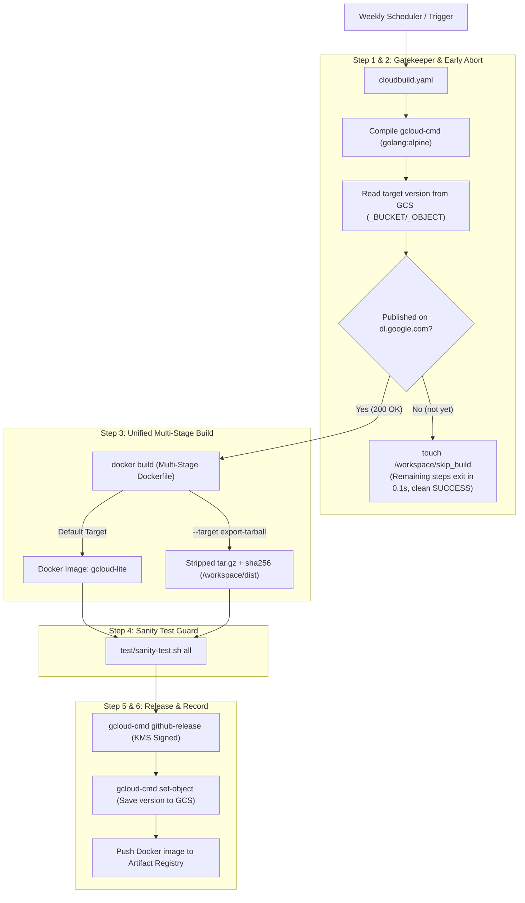
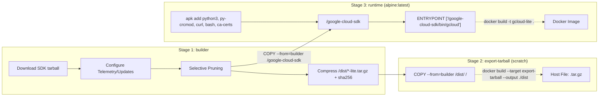

# gcloud-lite Architecture & Pipeline Design

This document details the architecture, design rationale, and operational lifecycle of **gcloud-lite**, an optimized, stripped distribution of the Google Cloud SDK CLI.

---

## 1. Overview & Goals

Google Cloud's official `google-cloud-cli` distribution is over **2.8 GB** uncompressed, containing complete embedded Python runtimes, large binaries (such as Anthos), hundreds of unused AWS service schemas, and unnecessary documentation and caches.

**gcloud-lite** achieves an **85%+ size reduction** (~350 MB container image, ~80 MB compressed tarball) while maintaining 100% backward compatibility with core tools: `gcloud`, `gsutil`, `bq`, and storage interoperability.

---

## 2. End-to-End Pipeline Architecture

The entire weekly release process is consolidated into a single root [cloudbuild.yaml](file:///home/tonymet/sotion/gcloud-lite/cloudbuild.yaml):

---

## 3. Multi-Stage Dockerfile Architecture

The [Dockerfile](file:///home/tonymet/sotion/gcloud-lite/Dockerfile) uses a 3-stage pattern to build both the container image and exportable tarball from a single source of truth:

### Key Stages:
1. **`builder`**:
   - Stream unpacks upstream archive (`curl ... | tar -xz`).
   - Configures non-interactive defaults (`core/disable_usage_reporting`, `disable_update_check`).
   - Applies selective stripping (see Section 4).
   - Generates the compressed standalone `.tar.gz` and `.sha256` in `/dist/`.
2. **`export-tarball` (`FROM scratch`)**:
   - Copies `/dist/` to root. Used by BuildKit's local export to extract the release tarball to host in seconds without running a container.
3. **`runtime` (Default Final Stage)**:
   - Minimal Alpine base with system Python 3, fast C-compiled `py3-crcmod`, `ca-certificates`, and `bash`.
   - Copies the already-stripped `/google-cloud-sdk` directly from `builder`.
   - Leaves zero intermediate build tools (`pigz`, caches) in the runtime layers.

---

## 4. Stripping Invariants & Rationale

| Target Path | Action | Rationale | Size Saved |
| :--- | :--- | :--- | :--- |
| `platform/bundledpythonunix` | Removed | Container runtime provides clean system Python 3 | ~120 MB |
| `bin/anthoscli` | Removed | Heavy binary not required for core CLI operations | ~70 MB |
| `lib/third_party/botocore/data/` | **Selectively Pruned** | Only `s3*` models are retained; 350+ unused AWS models (EC2, SageMaker, IoT, etc.) are deleted. Enables `gcloud storage rsync` while eliminating bloat. | ~75 MB |
| `deb/`, `rpm/` | Removed | Upstream Linux package manager metadata not needed in containers | ~10 MB |
| `.install/.backup`, `.install/*cache` | Removed | Residual component manager cache from build phase | ~25 MB |
| `__pycache__`, `*.pyc`, `*.pyo` | Deleted | Python bytecode stripped; `PYTHONDONTWRITEBYTECODE=1` prevents runtime regeneration | ~30 MB |

---

## 5. Runtime Configuration & Telemetry Suppression

To prevent container hangs and suppress background network calls in headless/CI environments, the following environment variables are set by default in the image:

* `CLOUDSDK_CORE_DISABLE_PROMPTS=1`: Disables all interactive confirmation banners (e.g. attempting to install missing optional components fails immediately rather than hanging on stdin).
* `CLOUDSDK_COMPONENT_MANAGER_DISABLE_UPDATE_CHECK=1`: Completely disables background update polling.
* `CLOUDSDK_CORE_DISABLE_UPDATE_CHECK=1`: Redundant safeguard against core update prompts.
* `CLOUDSDK_CORE_DISABLE_USAGE_REPORTING=true`: Disables Google telemetry reporting.
* `PYTHONDONTWRITEBYTECODE=1`: Prevents Python from writing `.pyc` files into the container's writable layer.
